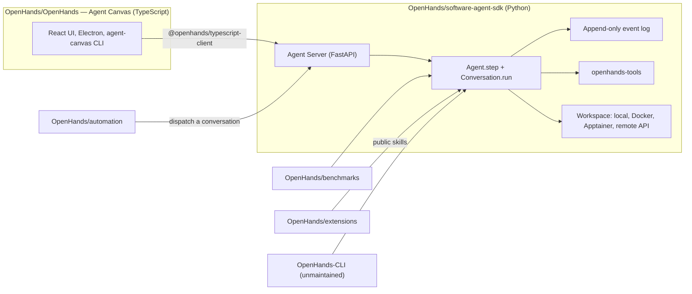
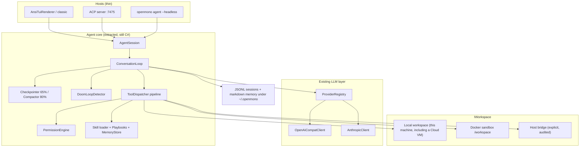

# OMA agent framework plan

Design only. This document records how OpenHands is built today, what OpenMonoAgent (OMA) already has, and a phased plan for an agent framework on top of this repository. No framework code ships with this document.

Reviewed 26 November 2026, read-only, from shallow clones outside this repo:

| Tree | Commit | What it actually is |
|---|---|---|
| [OpenHands/OpenHands](https://github.com/OpenHands/OpenHands) `6deb332` | 26 Nov 2026 | **Agent Canvas** 1.46.0. React 19 / TypeScript frontend, Electron desktop, and local-stack launcher. MIT. |
| [OpenHands/software-agent-sdk](https://github.com/OpenHands/software-agent-sdk) `d726333` | 25 Nov 2026 | Python 3.12+ SDK, tools, workspaces, and the Agent Server (packages at 1.64.1). MIT. This is the agent framework. |
| [OpenHands/benchmarks](https://github.com/OpenHands/benchmarks) `07f0e16` | 24 Nov 2026 | Public eval harness for SDK V1. MIT. |
| [OpenHands/OpenHands-CLI](https://github.com/OpenHands/OpenHands-CLI) | README as of this review | MIT CLI. The project README says it is no longer actively maintained and points people at Agent Canvas. |
| OMA `main` `e4b8eae` | this repo | .NET 10 coding agent. AGPL-3.0. |

The historical Python layout (`openhands/controller`, `openhands/events`, `openhands/runtime`, `openhands/agenthub` inside the OpenHands repo) is gone from `main`. Mapping that layout onto the current tree would describe a codebase that is no longer there.

---

## 1. OpenHands as it exists now

OpenHands is a multi-repository system. Agent Canvas is the control surface. The Software Agent SDK is the engine. Automation, the TypeScript client, the public skills registry, the CLI, and the benchmarks repo sit beside them.



Canvas README and `AGENTS.md` state the ownership rule in one sentence: the SDK decides what runs; automation decides when work runs; Canvas renders and selects a backend. Canvas does not execute actions, own the sandbox, or hold LLM credentials except by passing them to a backend.

### 1.1 Agent loop and controller

There is no class named `AgentController` anymore. The loop is split:

- `Agent.step` (`openhands-sdk/.../agent/agent.py`) is one reasoning step. It drains unmatched actions first (confirmation mode), builds the LLM view, may emit a condensation event and return, calls `LLM.generate` with the registered tools, turns tool calls into `ActionEvent`s, and executes them through a parallel executor. Read-only tools can overlap. A `finish` action ends the conversation. Malformed tool calls and content-policy blocks are turned into user-role messages so the loop can continue. A context-window or malformed-history error asks the condenser to run, then retries.
- `LocalConversation._run` is the controller. It moves execution status (`IDLE`, `RUNNING`, `PAUSED`, `WAITING_FOR_CONFIRMATION`, `FINISHED`, `STUCK`, `ERROR`), runs stop hooks, calls `agent.step` until a terminal status, and enforces `max_iteration_per_run` plus a budget. Getting stuck or hitting the iteration cap sets status and returns; it does not raise. `RemoteConversation.run` raises `ConversationRunError` for the same conditions.
- A stuck detector watches repeated action patterns, analogous to a doom-loop guard.
- `ACPAgent` is a second agent implementation. It does not call an LLM itself. The server spawns an external ACP CLI (Claude Code, Codex, Gemini CLI, Pi, OpenCode) and relays turns over JSON-RPC stdio. The external agent owns its model, tools, and execution.

`Conversation.send_message` plus `Conversation.run()` is the embedded API. The same types back the server.

### 1.2 Event stream

The conversation state is an append-only event log, one event file per event under the conversation directory, with a lock file and a length marker (`event_store.py`). Events are pydantic models. `LLMConvertibleEvent` is the subset that becomes chat messages.

Kinds include `SystemPromptEvent`, `MessageEvent`, `ActionEvent`, `ObservationEvent`, `AgentErrorEvent`, `UserRejectObservation`, `Condensation` / `CondensationRequest` / `CondensationSummaryEvent`, `PauseEvent`, `InterruptEvent`, streaming deltas, token counts, hook executions, security analysis, and conversation-state updates. A `View` projects the log into the messages the model sees. Condensation rewrites that view without deleting the underlying log, so a UI can replay history after the model context has been summarized.

Secrets are masked before events are written. State is saved when the conversation lock is released.

### 1.3 Action and observation model

A tool call is an `ActionEvent`: thought, optional reasoning/thinking blocks, tool name, tool-call id, the raw `MessageToolCall`, and a parsed `Action`. The matching result is an `ObservationEvent` with an `action_id`, the tool's `Observation`, and optional `extended_content` (path-scoped rules injected after the tool result). `to_llm_message()` turns an observation into a `role=tool` message.

Actions that fail schema validation, are rejected by the user, or are blocked by a hook still occupy a slot in the log (`AgentErrorEvent`, `UserRejectObservation`) so the tool-call / tool-result pairing the provider expects stays intact.

Confirmation mode writes the action and waits. The next `run()` treats the pending action as approved and executes it. That is the security gate at the event layer, separate from shell scanning.

### 1.4 Runtime and sandbox

`Workspace` is the boundary around the filesystem and the shell. Implementations live in `openhands-workspace`:

| Workspace | Behavior |
|---|---|
| Local | Agent process cwd. Full host filesystem access. Canvas warns about this. |
| `DockerWorkspace` | Starts a prebuilt `ghcr.io/openhands/agent-server` image, waits until it is healthy, and talks to it over HTTP. Working dir inside the container is `/workspace`. |
| `DockerDevWorkspace` | Builds an image on the fly from a base image. |
| Apptainer | HPC-style sandbox. |
| Remote API / cloud | Client of a workspace that already exists somewhere else, including OpenHands Cloud. |

Agent Server can also start **one container per conversation** (`OH_CONVERSATION_RUNTIME=docker`). Canvas itself stays on the host; only the conversation's agent server and tools move into the container. The container mounts that conversation's workspace and state.

The agent-server image is a full environment (Python, Node, a terminal, optional browser, a code-server proxy). It is a product image, not a small library.

### 1.5 Tools

`openhands-tools` registers tools as pydantic action/observation pairs. The default surface re-exports terminal, file editor, task tracker, task/delegation, workflow, and an "ask oracle" tool. Also present, and imported directly when needed:

| Tool | Role |
|---|---|
| `TerminalTool` | Shell via libtmux, not a one-shot `bash -c`. Sessions survive across calls. |
| `FileEditorTool` | View, create, and str-replace edit. |
| `apply_patch` | Patch application. |
| `glob`, `grep` | Search. |
| Gemini-shaped read/write/list/edit | Schema variants for Gemini tool calling. |
| `BrowserToolSet` | `browser-use` (MIT). Navigate, click, type, scroll, tabs, storage, page content. Deliberately not on the default import path, because the dependency is heavy. |
| `TaskToolSet` / `delegate` / `child_conversation` | Sub-agents and child conversations. |
| `ask_user` | Blocking question to the operator. |
| `task_tracker` | Todo list. |
| MCP | Configured servers become tools at runtime. |
| Skill tools | A skill can expose commands that the SDK turns into tools. |

Built-in sub-agent presets ship as markdown under `preset/subagents`. A security layer can attach a predicted `security_risk` field to tool calls. `defense_in_depth` statically scans shell commands. `GraySwanAnalyzer` posts the history to Gray Swan's Cygnal API (see licensing).

### 1.6 LLM abstraction

`openhands.sdk.llm.LLM` is one large pydantic model over **LiteLLM** (`litellm==1.108.3` is pinned in the workspace). It speaks Chat Completions and the OpenAI Responses API, streams tokens, counts tokens with a chat-template tokenizer, retries, falls back across models, routes (random, multimodal), and stores provider credentials and "LLM profiles". Model metadata is resolved from LiteLLM's tables plus a runtime probe of the live endpoint.

Non-vision models that receive images either expose a vision-inspect tool or finish the turn with an explanation. Function-call conversion has a non-native path for models that cannot emit tool calls.

This is a broad router. It is also a dependency and upgrade surface OMA does not have, and does not need, because OMA already speaks OpenAI-compatible HTTP and the Anthropic native API.

### 1.7 Memory and condensers

Condensers implement `condense(view) -> View | Condensation`. If they return a `Condensation`, the agent emits that event and does not sample a new action. The next step sees the shortened view. Shipped strategies:

- `NoOpCondenser`
- `LLMSummarizingCondenser` — an LLM writes a summary of the dropped span
- `PipelineCondenser` — condensers composed in order

Rolling condensers decide from token counts against the model's real context limit (resolved before the first step). The log itself is kept. There is also a critic (`APIBasedCritic` and rule critics such as empty-patch) that can score a step and trigger another refinement pass. That critic calls a separate HTTP endpoint and downloads a Hugging Face tokenizer on first use.

Cross-session memory in the SDK is skills plus conversation persistence, not a separate memory file store.

### 1.8 Microagents and skills

The old microagent concept (a markdown file with a trigger that gets injected into the prompt) is now a **skill**. `Skill` loads `SKILL.md` directories and loose markdown, with YAML frontmatter, and three triggers:

- keyword
- path glob (gitignore-style, so a rule can attach when a tool touches `**/*.cs`)
- task (a skill the model can invoke, with declared inputs)

Skills can carry MCP server config and shell commands that become tools. Repositories can be pinned and cached. `AgentContext(load_public_skills=True)` pulls the public marketplace from [OpenHands/extensions](https://github.com/OpenHands/extensions) (MIT), which includes packaging skills such as `uv` and `deno`. Agent Canvas also consumes that registry for UI.

OMA's playbooks are a stricter object: ordered steps, typed parameters, gates, and checkpoint/resume. OpenHands skills are prompt fragments and optional tools, not workflows.

### 1.9 Server and frontend

**Agent Server** (`openhands-agent-server`) is FastAPI. `agent-server` is the console script. Routers include server info, conversation lifecycle, WebSocket event streams, bash and terminal sockets, files, git, settings, skills, tools, sub-agents, plugins, hooks, LLM profiles, MCP (including an OAuth redirect), workspaces, projects, VS Code proxy, and an experimental-features flag. Persistence uses the file event log plus SQLAlchemy/SQLite for server-side records. An optional `posthog` extra exports product analytics; the core server imports without it.

**Agent Canvas** (`src/` in the OpenHands repo) is the frontend:

- React Router 8, Vite, Tailwind 4, Zustand, TanStack Query, Monaco, xterm, i18next.
- `src/api` is the only place that should call the server. It uses `@openhands/typescript-client`.
- One UI can attach to many Agent Servers (laptop, a Mac mini, a VM, OpenHands Cloud) and switch without dropping the conversation list.
- `agent-canvas` starts the full local stack: Agent Server and the automation backend via `uvx`, plus an ingress proxy. `--frontend-only` and `--backend-only` split that. Listeners bind to loopback unless `--host` / `--public` is set.
- Electron packaging bundles Node and `uv` for a desktop app.
- Playwright covers mock-LLM and live end-to-end. Unit tests are Vitest.

Canvas is a product. It is not the framework.

### 1.10 CLI and headless modes

Three surfaces, only one of which is the maintained product:

| Surface | Status | Modes |
|---|---|---|
| SDK `Conversation.run()` | The real headless API | In-process. No UI. |
| Agent Server | The real remote API | HTTP + WebSocket. Canvas and automation speak this. |
| `openhands` CLI | MIT, README says unmaintained | TUI (`openhands`), ACP (`openhands acp`), headless (`openhands --headless -t "task"`), a browser TUI (`openhands web`), and `openhands serve` which fronts Canvas. Config under `~/.openhands/`. |
| `agent-canvas` | Maintained launcher | Local stack, Docker sandbox, per-conversation Docker. |

Headless in the SDK sense is "construct an `Agent`, call `run()`, exit". Headless in the CLI sense is a flag on an unmaintained binary. New work should target the SDK or Agent Server, not the CLI's flag set.

### 1.11 Eval harness

Two layers:

1. **Public harness** — `OpenHands/benchmarks` (MIT). A uv workspace with a pinned SDK submodule. Each benchmark is a `run_infer.py` plus `eval_infer.py`. Active suites include SWE-bench, SWE-bench Pro, SWE-bench Multimodal, GAIA, Commit0, OpenAgentSafety, and ProgramBench. Inference builds a per-instance Docker image (`ghcr.io/openhands/eval-agent-server` or Apptainer), runs the SDK agent with a JSON LLM config, writes a trajectory, and scores it. Resume skips finished instances. A remote-workspace path scales out through a cloud runtime API. LLM configs point at LiteLLM, including a private eval proxy (`llm-proxy.eval.all-hands.dev`) in the example.
2. **Internal dispatch** — `software-agent-sdk/.github/workflows/run-eval.yml` fires `OpenHands/evaluation` workflow `eval-job.yml` with a bot PAT. That repository returned 404 to an unauthenticated lookup during this review, so it is private or renamed. The workflow's own skill describes Kubernetes jobs and Datadog. That cluster, the proxy, and the dashboards are not part of the public tree.

The harness is a consumer of the SDK. It is not inside the agent loop.

### 1.12 Licensing — what we must not copy

OMA is AGPL-3.0. The OpenHands trees we are allowed to read are MIT. MIT permits reuse, including inside an AGPL project, **if the MIT copyright and permission notice stay on the copied portion**. A clean-room C# implementation keeps this repository a single-license tree. That is the plan. Copying Python or TypeScript in and re-licensing it as if OMA wrote it is not.

These items are **not** covered by that MIT grant, or are MIT code we still must not treat as ours to vendor:

| Item | Why it stays out |
|---|---|
| OpenHands name, logo, and `assets.openhands.dev` artwork | Trademark and brand. The MIT license does not grant them. |
| OpenHands Cloud, Enterprise sandboxes, and `llm-proxy.eval.all-hands.dev` | Hosted commercial infrastructure. Not in the public agent source. |
| `OpenHands/evaluation` and its Kubernetes/Datadog ops | Not publicly readable from here. Do not reconstruct it. |
| Gray Swan Cygnal (`sdk/security/grayswan`) | The Python client sits in the MIT SDK, but the service is a third-party paid API (`GRAYSWAN_API_KEY`, policy id). Do not copy the client, and do not call the API. OMA's permission engine is the safety gate. |
| `tom-swe` / AskOracle / [OpenHands/ToM-SWE](https://github.com/OpenHands/ToM-SWE) | Archived. GitHub reports **no license**. Do not copy. |
| `elkjs` inside Agent Canvas's lockfile | Transitive dependency of Mermaid. License is **EPL-2.0 OR GPL-3.0-or-later**. Do not copy that package. We are not taking the Canvas frontend. |
| VS Code product bits, the agent-server code-server proxy, and extension payloads | Different upstream licenses and a different editor story. OMA already speaks ACP to its own VS Code extension. |
| SWE-bench and other benchmark **datasets** | Princeton NLP and other upstreams set their own terms. Do not commit dataset contents. |
| PostHog wiring, telemetry identity, and Cloud funnel events | Optional even inside OpenHands. OMA is local-first and does not add a product-analytics SDK. |
| Agent Canvas UI, Electron builder config, and npm dependency tree | MIT at the repo root, mixed licenses underneath (elkjs is the copyleft one identified in this pass). A full transitive audit was not done because we will not port the UI. |

`browser-use` is MIT. Reading it later is fine. Vendoring it into the .NET agent is a product choice, not a license shortcut: OMA already fetches pages through Scrapling.

Skills in the wild declare their own `license` frontmatter field (the SDK even tests `Apache-2.0`). A skill we load at runtime is data. A skill we commit into this repo has to be compatible with AGPL-3.0, or it stays an external file the user opts into.

---

## 2. What OMA is today

OpenMono is a local-first coding agent. The tagline in the README is accurate: a .NET 10 CLI, a llama.cpp (or Strata) inference server, and a Docker sandbox, aimed at a machine the operator owns. AGPL-3.0. About 278 C# files across four projects, with 74 test files.

```
src/OpenMono.Cli/        agent loop, tools, LLM clients, TUI, ACP server, playbooks
src/OpenMono.Core/       AppConfig, session state, permissions store, playbook model, host-exec types
src/OpenMono.HostBridge/ bare-metal daemon that pairs with a sandboxed agent
src/OpenMono.Tests/      xUnit
```

`global.json` pins the .NET SDK to 10.0.403 with `latestMinor` roll-forward. There is no web frontend in this repository. The VS Code / Cursor extension and the mobile apps are separate products that speak ACP.

### 2.1 Stack and processes

One `openmono` binary. Inference is a different process, usually `llama-server` in Docker on port 7474, speaking OpenAI-compatible `/v1/chat/completions`. Strata (MIT, Linux, NVIDIA, high-RAM) is the supported high-end engine and also speaks that API. Prism, used for the Bonsai quants, is selected by the installer and is **not** a C# provider. The CLI reaches it through the same local endpoint.

Deployment shapes, already documented in `docs/DEPLOYMENT-MODES.md`:

- **Single-box.** Agent and inference on one machine.
- **Split-box, direct.** Agent on the working machine, inference on a GPU machine on the LAN.
- **Split-box, relay.** Inference tunnelled outbound through `app.openmonoagent.ai`. The agent box only needs `llm.endpoint` and `llm.api_key`.

Agent execution shapes:

- **Sandbox (default).** The agent runs in Docker. The project is bind-mounted at `/workspace`. That mount is the blast radius.
- **Host.** `OpenMono.HostBridge` is an ACP client of the sandboxed agent and the only process allowed to run on the metal. Commands go through `HOST_EXEC`, an allow/deny policy, a run-as identity, and an audit log. The extension refuses `--host` on purpose.

A Caddy gateway on the inference box fans `/v1` to llama-server, `/search` to SearXNG, and `/scrape` to Scrapling. `WebSearch` and `WebFetch` use it and fall back to DuckDuckGo and a direct HTTP fetch.

### 2.2 Agent loop

`ConversationLoop` is the controller and the step function in one type. Startup in `Program.cs` probes `/props` (then `/v1/models`), builds a `SessionState`, and wires config, renderer, permissions, memory, hooks, LSP, MCP, playbooks, the tool registry, and an `ILlmClient`.

Per user turn:

1. Slash commands dispatch to `CommandRegistry`.
2. Above 65% of the real context window, `Checkpointer` asks the model for a summary and stores it with a cutoff index.
3. Above 80%, `Compactor` summarizes everything except the last four turns.
4. The loop streams the model for up to **1,000** iterations. Chunks are thinking, text, tool-call deltas, and usage.
5. Tool calls run through the pipeline below. Read-only, concurrency-safe tools run with `Task.WhenAll`. Writes are serial. Read-only work can start while the stream is still open.
6. The turn ends when the model returns text and no tool calls. The session is written as JSONL.

`DoomLoopDetector` hashes recent tool-call batches (period 1–4). The first repeat nudges, the third escalates the nudge, the fifth ends the turn. A clean window clears the streak.

Sub-agents (`AgentTool` + `Agents/AgentDefinition`) spawn an isolated session that reuses the parent's permission engine, with a locked tool list and a turn budget: Explore 100, Plan 100, Coder 300, Verify 150, general-purpose 200.

### 2.3 Tools

21 built-in tools, each an `ITool` with a JSON schema, `IsReadOnly`, `IsConcurrencySafe`, a permission level, and a capability list. The dispatcher pipeline is fixed:

parse JSON → schema validate → path sanity → plan-mode gate → host-mode gate → `PermissionEngine` → read-only cache → pre-hook → execute → post-hook → artifact store (results over 10 KB) → cache write → file-cache invalidation.

| Tool | Role |
|---|---|
| `FileRead`, `FileWrite`, `FileEdit`, `ApplyPatch` | Workspace files |
| `Glob`, `Grep`, `ListDirectory` | Search |
| `Bash` | Shell, confined by `PathGuard` in the sandbox |
| `HostExec` | Metal commands, only when host mode is paired |
| `WebSearch`, `WebFetch` | Gateway, with public fallbacks |
| `Agent` | Sub-agents |
| `AskUser` | Operator question; also the channel for host-exec consent |
| `TodoWrite` | Task list |
| `PlanMode` | Read-only vs build |
| `Playbook` | Run a playbook |
| `MemorySave` | Cross-session memory |
| `ToolSearch` | Find a tool |
| `Lsp` | hover, definition, references |
| `Roslyn` | C# workspace: callers, hierarchy, diagnostics, blast radius. 5-minute compilation cache |

MCP servers are spawned, listed, and registered as `mcp__{server}__{tool}`. `code-review-graph` is auto-detected. Graphify is detected as a CLI, not as an MCP server. LSP servers start lazily (OmniSharp, typescript-language-server, pylsp, gopls, rust-analyzer).

Capabilities (`FileReadCap`, `FileWriteCap`, `ProcessExecCap`, `NetworkEgressCap`, `VcsMutationCap`, `AgentSpawnCap`) are the primary permission model. Decision order is session deny, config deny, session allow, config allow, then an interactive prompt (once / session / deny). A legacy `AutoAllow | Ask | Deny` level remains as fallback.

Hooks are shell snippets in settings: `SessionStart`, `PreToolUse`, `PostToolUse`, 30 seconds each, filterable by tool name and input substring.

### 2.4 LLM layer — the convention to keep

`ILlmClient.StreamChatAsync` yields `StreamChunk` (thinking, text, tool call, usage). `ProviderRegistry` constructs the client from settings.

| Provider name | Client | Default endpoint |
|---|---|---|
| `local` | `OpenAiCompatClient` | `http://localhost:7474` |
| `strata` | `OpenAiCompatClient` | `http://localhost:7474` |
| `openai` | `OpenAiCompatClient` | `https://api.openai.com` (`OPENAI_API_KEY`) |
| `ollama` | `OpenAiCompatClient` | `http://localhost:11434` |
| `anthropic` | `AnthropicClient` (native, in `AnthropicClient.cs`) | Anthropic API |

`OpenAiCompatClient` appends `/v1/chat/completions`, so every OpenAI-compatible server — llama.cpp, Strata, Prism, Ollama, OpenAI, a future gateway — is one client. Anthropic is the exception because its tool-use and thinking streams are not that API. The README marks OpenAI, Anthropic, and Ollama as available but WIP. Local llama.cpp is the default. Strata is the supported Linux high-end backend.

Settings load in order: built-in defaults, `~/.openmono/settings.json`, `.openmono/settings.json`, `--config`, environment variables, CLI flags. Relevant variables include `OPENMONO_PROVIDER`, `OPENMONO_ENDPOINT`, `OPENMONO_MODEL`, `OPENMONO_API_KEY`, `OPENMONO_MODEL_PRESET`, `OPENMONO_DATA_DIR`, `OPENMONO_WORKSPACE`, `OPENMONO_CONTEXT_SIZE`. `/model` switches the model on the **active** provider. It does not switch provider.

A new provider is a class that implements `IProvider` and is registered in `ProviderRegistry`. A new HTTP dialect is justified only when `OpenAiCompatClient` cannot speak it. LiteLLM is that kind of new dialect, and this plan does not add it.

### 2.5 Storage — the convention to keep

Everything durable is files under `~/.openmono` (`AppConfig.DataDirectory`), overridable with `OPENMONO_DATA_DIR`.

| Data | Format | Path |
|---|---|---|
| Settings | JSON | `~/.openmono/settings.json` |
| Session | JSONL, line 1 is a header, then one message per line | `~/.openmono/sessions/{date}_{id}.jsonl` |
| Checkpoints | JSON array beside the session | `{date}_{id}.checkpoints.json` |
| Memory | Markdown + YAML frontmatter, plus `MEMORY.md` index | `~/.openmono/memory/` |
| Host bridge | JSON, mode 0600, no secrets | `~/.openmono/host-bridge.json` |
| Playbook run state | files written by `PlaybookExecutor` under the data dir | per run id |
| Undo snapshots | file history | `OpenMono.Core/History` |

Messages are `Message` records: role, content, tool calls, tool-call id, tool name. That is the source of truth. There is no separate event type hierarchy. Compaction replaces older messages in the window the model sees and records a checkpoint; the JSONL file keeps the transcript the loop saved.

No database. Adding SQLite or Postgres for the agent core would be a new storage system. This plan does not.

### 2.6 The pieces that already match a framework

OMA is not a prompt wrapper waiting for an architecture. These are the framework, living inside the CLI:

- A streaming tool loop with a hard iteration cap and a doom-loop policy.
- A schema-validated tool pipeline with capabilities, plan mode, and hooks.
- A Docker sandbox plus an audited host escape hatch.
- A two-client LLM layer that already covers local and hosted models.
- Context management tied to the server's real window (`/props`), not a hardcoded 128k.
- Sub-agents with tool allow-lists.
- MCP and LSP.
- Playbooks: YAML frontmatter, typed parameters, gates, checkpoint/resume. This is further along than OpenHands skills for repeatable engineering work.
- Cross-session memory as markdown the model can write (`MemorySave`).
- ACP on `:7475` so an editor is a client, not a second agent.
- A TUI (`AnsiTuiRenderer`) and a classic scrolling renderer. Redirected stdin/stdout already selects classic, which is the headless-ish path.
- Roslyn and the graph tools, which OpenHands does not have in-tree.

### 2.7 Strengths worth protecting

- **Local inference is the default**, with an installer that picks a model from VRAM and RAM. OpenHands assumes a hosted model and a LiteLLM name.
- **The blast radius is explicit.** Sandbox mount, or host mode with consent and an audit log. OpenHands' local mode is "the agent has your filesystem" plus a warning.
- **The permission system is capability-based** and runs before the tool, in-process. OpenHands splits this across confirmation mode, a predicted risk field, a shell scanner, and an external analyzer.
- **One language and one license** for the agent, the bridge, and the tests.
- **Split-box is a first-class install role**, including a relay, so a laptop can drive a GPU machine the operator owns.
- **C# code intelligence** (Roslyn) is in the tool list, not a plugin the user has to discover.

The CLI composition root (`Program.cs`) still owns the loop. A library consumer today would reference `OpenMono.Cli` and pull the TUI with it. That coupling is the main structural gap, and it is smaller than "we need an agent framework".

---

## 3. Gap analysis

Rows are the OpenHands components from the request. "Reuse" means call the existing OMA type. "Build" means new code in this repo, in C#, on the existing LLM and file-storage conventions.

| OpenHands piece | OMA today | Reuse | Build |
|---|---|---|---|
| Agent loop / controller | `ConversationLoop`, 1000-iter cap, doom-loop | The loop, the doom-loop, sub-agent budgets | A host-agnostic session type so TUI, ACP, and a headless command share one loop without the renderer in the constructor |
| Event stream | JSONL messages | `SessionManager` append + atomic rewrite | Nothing in the MVP. A typed event log is a later, optional projection over the same JSONL |
| Action / observation | `ToolCall` + tool result messages | `ITool`, `ToolDispatcher`, `ToolResult` | Keep tool results as messages so provider pairing stays what `OpenAiCompatClient` and `AnthropicClient` already send |
| Runtime / sandbox | Docker `/workspace`, `PathGuard`, host bridge | Both modes, as they are | A small `IWorkspace` so the loop asks "run this" instead of assuming a container. Local-on-this-machine is the Cloud VM case |
| Bash | `BashTool` | As-is | A persistent tmux session is optional later. One-shot bash is enough for the MVP |
| File edit | `FileEdit`, `FileWrite`, `ApplyPatch` | As-is | — |
| Browser | `WebFetch` via Scrapling/Camoufox, `WebSearch` via SearXNG | The gateway | An interactive browser toolset is out of the MVP. `browser-use` is not added |
| LLM abstraction | `ILlmClient`, `ProviderRegistry`, two HTTP clients | The whole layer | A headless run must select the provider with `OPENMONO_PROVIDER` and existing keys. No LiteLLM, no new provider |
| Memory | `MemoryStore` markdown | As-is | — |
| Condensers | Checkpoint at 65%, compact at 80%, real window from `/props` | Both | An `ICondenser` interface only if a third strategy appears. The two thresholds stay the behavior |
| Microagents / skills | `OPENMONO.md`, memory files, playbooks, hooks | Playbooks for workflows, memory for facts | A thin skill loader: markdown + the same YAML frontmatter as memory, keyword and path triggers, injected into the system prompt. No marketplace |
| Server | ACP HTTP/SSE on `:7475` | ACP for editors and for the host bridge | A second REST server is out of the MVP |
| Frontend | TUI, classic renderer, external extension | All three | No Agent Canvas port |
| CLI / headless | TUI by default, classic when stdio is redirected | Classic mode | `openmono agent --headless --task "..."` that runs one task to completion and exits with the session id |
| Eval harness | None in-repo | Session JSONL as the trajectory format | A later, separate runner for a handful of SWE-bench instances. Do not import `OpenHands/benchmarks` |
| Critic, Gray Swan, confirmation-by-second-run | Permission engine + hooks + plan mode | Those | Leave Gray Swan and the paid critic out |

The overlap is the reason the MVP is an extraction and a headless entry point, not a new runtime.

---

## 4. Proposed architecture

### 4.1 Principles

1. **One agent core, three hosts.** TUI, ACP, and headless all call the same session. The renderer is a listener.
2. **Stay on `ILlmClient`.** Local, Strata, Ollama, and OpenAI stay on `OpenAiCompatClient`. Anthropic stays on `AnthropicClient`. A provider that speaks OpenAI-compatible HTTP is a new `IProvider` with an endpoint, not a new client.
3. **Stay on files.** Sessions remain JSONL under the data directory. Settings remain JSON. Memory and skills remain markdown with YAML frontmatter. No database in the core.
4. **The sandbox is a workspace, the VM is just one place a workspace can run.** Cursor Cloud is a development and execution host. It is not a library the agent imports, and a self-hosted OMA install never talks to Cursor.
5. **AGPL stays the only license on code we commit.** Ideas from the MIT SDK get reimplemented. The items in section 1.12 stay out.
6. **Local inference remains the default product path.** Cloud development uses a key or the existing relay because a Cloud VM is not the GPU box OMA targets.

### 4.2 Shape



`AgentSession` is the new seam. It owns `SessionState`, the loop, the tool registry, and the workspace. It exposes `SendAsync` and `RunAsync`, and it raises the same events the TUI already renders (text delta, thinking, tool start, tool end, usage, permission request, done). `Program.cs` becomes the composition root that picks a host and a workspace. `ConversationLoop` moves behind that seam with its current behavior intact: 1000 iterations, doom-loop tiers, 65/80 compaction, parallel reads.

`IWorkspace` is three methods the tools need and do not already have as an interface: read a path, write a path, run a process. `BashTool` and the file tools call it. The Docker sandbox and the host bridge stay the implementations they are. The local workspace is "paths on this machine, `PathGuard` rooted at the working directory". On a Cursor Cloud VM that root is the checkout.

Skills, when they arrive, are markdown files in `.openmono/skills/` and `~/.openmono/skills/`, parsed the way `MemoryStore` parses frontmatter. A keyword skill is appended to the system prompt when the user text matches. A path skill is appended to the tool result when an edit touches a matching glob, which is the one OpenHands behavior worth copying in spirit (`extended_content` on an observation). Playbooks stay the workflow engine. A skill does not grow steps, gates, or parameters; a playbook already has those.

The event log stays the JSONL transcript. Checkpoint records already exist beside it. If a later UI needs to replay a condensation without rewriting history, the checkpoint file is the place to hang that, not a new one-file-per-event store.

### 4.3 What the MVP deliberately leaves inside the CLI

Roslyn, LSP, MCP, the Caddy gateway, playbook execution, and the host bridge are already factored enough to call from the session. They do not need new abstractions to ship a headless run. Moving them into a new project is cosmetic until a second process needs them.

A new project `src/OpenMono.Agent/` is justified only when the extraction is real: the session, the loop, the tool contracts, and the LLM interfaces, with `OpenMono.Cli` and `OpenMono.HostBridge` referencing it. Doing that in the MVP keeps the TUI from leaking into library tests. Doing it as a rename-only move, with the TUI types still underneath, is not worth the diff.

### 4.4 Development and execution on Cursor Cloud

Cursor Cloud Agents boot an isolated VM from an environment snapshot. The snapshot has two layers: a base image, and a repository `install` that is baked in when a build succeeds. `start` runs on every agent boot, detached, and is where long-running processes belong. Secrets are environment variables configured on the environment. They never go in `environment.json`, a Dockerfile, or the repo.

This repository has **no** `.cursor/environment.json` today. An agent started without a configured environment gets Cursor's default image and skips `install`. That is enough to read and edit the repo. It is not enough to `dotnet test` reliably, and it is not a GPU box.

Recommended environment, when someone is ready to add one (this document does not add it):

| Piece | Choice |
|---|---|
| Base | Cursor default image, or a small Dockerfile that installs the .NET 10 SDK **10.0.403+** and Docker. `user` is `ubuntu` on that image. |
| `install` | `dotnet restore` / `dotnet build` of `OpenMono.sln` so the snapshot already compiles. Idempotent, must exit. |
| `start` | Empty for library work. Docker, if the image includes it, is started here and must tolerate a second boot. llama-server does **not** start here: the model weights and the GPU are not this VM. |
| Secrets | `OPENMONO_API_KEY` and, when the provider needs them, `OPENAI_API_KEY` or the Anthropic key the existing client already reads. `OPENMONO_PROVIDER`, `OPENMONO_ENDPOINT`, `OPENMONO_MODEL` can be secrets or non-secret env. |
| Data dir | `OPENMONO_DATA_DIR` pointed at a directory inside the VM (for example under the home directory), never at a path that gets committed. |
| Egress | Allow the model endpoint the run will call (OpenAI, Anthropic, or the operator's relay). Local llama on the VM is the wrong default. |

Three ways to **run** the agent once the framework entry point exists:

1. **Cloud VM as the local workspace (MVP).** `openmono agent --headless --task "..."` with the working directory set to the checkout. The VM is already isolated from the operator's laptop. `PathGuard` rooted at the repo is the sandbox. This needs no Docker-in-Docker and matches how Cloud Agents already edit this repository.
2. **OMA Docker sandbox inside the VM.** The existing `--sandbox` mode, project bind-mounted at `/workspace`. Requires Docker in the image and a `start` script that brings the daemon up. Use this when the task under test is the sandbox itself.
3. **Split-box, which is the local-model path.** The Cloud VM is an agent-only install (`llm.endpoint` pointing at the operator's GPU box, direct or via the existing relay). Inference stays on hardware OMA already supports. The VM holds source, tools, and the session JSONL. Secrets are the relay key (`OPENMONO_API_KEY`) and nothing else from the GPU machine.

A fourth option, spawning another Cloud Agent as the sandbox, makes Cursor a runtime dependency. That stays out. The framework has to run for someone who installed `openmono` from the shell script and has never opened Cursor.

Headless on the VM is also how we will test. A fake `ILlmClient` that returns a scripted tool call covers the loop in `dotnet test` with no network. A live smoke run uses a secret and a tiny task (`write a file, stop`) and is optional in CI.

AGPL note for this host: running OMA on a VM the operator controls, for the operator, is ordinary use. A future multi-tenant server that lets other people interact with a modified OMA over the network takes on AGPL's source-offer duty. The MVP does not build that server. ACP remains a local or trusted-client API, which it already is.

---

## 5. Phased roadmap

Sizes describe the change, not a calendar. **S** is a handful of files and tests. **M** crosses a project boundary or adds a new command path. **L** would be a new subsystem or a persistence rewrite. We are not doing the L items in the first implementation pass.

### Phase 0 — this document

Scope **S**. Land the plan. No runtime change.

### Phase 1 — MVP: one loop, headless, existing tools, existing models

Scope **M**. The invasive part is the composition root, not the loop body.

1. Introduce `AgentSession` (new project `OpenMono.Agent` if the move is real; otherwise a namespace inside `OpenMono.Cli` with no TUI references). Move `ConversationLoop` and the tool contracts it needs behind it. `Program.cs` constructs a session and a renderer.
2. Add `openmono agent --headless --task "<text>"` (and the same via env for non-interactive Cloud runs). Exit 0 when the turn ends with text and no tool calls. Exit non-zero on doom-loop abort, iteration cap, or LLM error. Print the session id and the final text.
3. Workspace for the MVP is the current process: sandbox when Docker is how the process was launched, local `PathGuard` otherwise. No new `IWorkspace` yet unless the extraction forces a seam; if it does, local and the existing sandbox are the only two implementations.
4. Provider selection stays `ProviderRegistry`. Headless refuses to start when the active provider fails `ValidateConfig`, with the same error the interactive path would show.
5. Tests: a scripted `ILlmClient` drives one tool round-trip and a doom-loop abort, without a live model. Existing tool dispatcher tests keep passing.

Done means a Cloud VM, or a laptop, can run one coding task to completion with `Bash` and the file tools, against either a local OpenAI-compatible server or an API key, and the transcript lands in the usual JSONL file.

### Phase 2 — skills and a condenser seam

Scope **S** to **M**, additive.

- Skill files with `name`, `description`, and `triggers` (keyword list or a path glob), stored and parsed like memory files.
- Inject keyword skills into the system prompt next to `OPENMONO.md`. Inject path skills onto the tool result that touched the file.
- Extract the 65% / 80% logic behind a single interface with one implementation, `ThresholdCondenser`, so a future strategy is a class and not a rewrite of the loop. Behavior of the thresholds stays.

### Phase 3 — workspace interface and stronger sandbox on Cloud

Scope **M**.

- `IWorkspace` with local, Docker, and host-bridge implementations moved behind it. Tools stop knowing which one they are in.
- Document and, if the operator wants it, add the Cloud environment file: .NET SDK in `install`, Docker in `start`, secrets for the relay or the API provider.
- Persistent shell sessions (tmux or a long-lived process) only if one-shot `BashTool` is showing up as a real limit in headless runs.

### Phase 4 — a small eval runner

Scope **M**, and only after Phase 1 is boringly solid.

- A separate `tests/eval` or `src/OpenMono.Eval` console project that reads a list of instance ids, runs `--headless` in a Docker workspace, and writes the existing JSONL plus the git patch.
- Score with the upstream SWE-bench harness the operator already trusts, invoked as a program, not by copying its Python.
- Start with a handful of SWE-bench Verified instances. Dataset files stay out of git.
- The private OpenHands evaluation cluster is not a template we can follow.

### Phase 5 — only if a product need shows up

Each of these is **L** and needs its own design:

- A browser tool with click/type/tabs. The scrape gateway already covers "read this page".
- An ASP.NET conversation API for a web UI. ACP already covers the editor.
- Multi-agent delegation beyond the five sub-agents.
- A critic model.
- A skill marketplace.
- Any storage that is not a file.

---

## 6. Open questions

1. **Library or sharper CLI?** This plan extracts a session so three hosts share it, and stops there. Publishing `OpenMono.Agent` as a NuGet package for other applications is a different commitment (stability, AGPL obligations for embedders). Recommendation: extract the project, do not publish it until someone outside this repo asks.
2. **Event log versus JSONL messages.** OpenHands' one-file-per-event log is what makes confirmation mode and lossless condensation easy. OMA's JSONL is what every current feature uses. Recommendation: keep JSONL through Phase 2. Revisit only if checkpoint/restore has to replay a condensation the message list can no longer express.
3. **Where do Cloud runs get a model?** A default-image VM has no useful GPU for Qwen 27B. Recommendation: API provider via secrets for framework development, and the existing split-box relay when the point of the run is to test local inference. Do not bake weights into the environment snapshot.
4. **Does `--headless` replace classic-with-a-pipe?** Classic mode already runs when stdio is redirected, but it still speaks the REPL. A task flag is a different contract: one task, then exit. Both should keep working.
5. **Interactive permissions in headless.** The permission engine prompts. Headless has no operator. Recommendation: headless defaults to the config allow/deny rules and denies anything that would have prompted, unless `OPENMONO_HEADLESS_PERMISSIONS=allow` is set explicitly. That matches the host bridge's "ask unless you opted into allow" posture.
6. **ACP as the only remote API.** Recommendation: yes through Phase 3. A web UI can be a later ACP client, the way the VS Code extension already is.
7. **Playbooks versus skills.** Recommendation: skills are prompt-time knowledge; playbooks remain gated workflows. Do not merge them.
8. **WIP hosted providers.** OpenAI, Anthropic, and Ollama are marked WIP in `docs/MODELS.md`. Phase 1 headless will exercise them. If they are too rough, the MVP's definition of done is the local OpenAI-compatible client plus one hosted provider that already passes a scripted test, and the WIP ones stay behind the same interface until their streams are trustworthy.
9. **Who owns the Cloud environment file?** Adding `.cursor/environment.json` changes how every Cloud Agent for this repo boots. That should be a separate change, reviewed as infrastructure, after Phase 1 has a command worth running there.

---

## 7. Summary recommendation

Build the framework by extracting the agent OMA already has. Phase 1 is `AgentSession` plus `openmono agent --headless --task`, on `ProviderRegistry` and JSONL sessions, with the Cloud VM treated as a local workspace and inference either on an API key or on the operator's existing GPU box. Leave the OpenHands frontend, LiteLLM, Gray Swan, the unlicensed theory-of-mind module, the private eval cluster, and a second server for a future that has a reason to want them.
