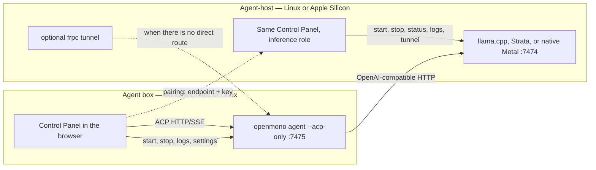

# OpenMonoAgent.ai Control Panel

Design only. This document plans the **OpenMonoAgent.ai Control Panel**: a browser UI that ships with the agent install, talks to the agent through the existing ACP server, and manages the agent and the agent-host once they are installed. The panel is installed last. It does not install OpenMono. No panel code ships with this document.

This file used to live at `docs/control-panel-plan.md`. It now lives in `src/cc/` with the rest of the Control Panel. The build-ready spec is [PLAN.md](PLAN.md). The HTTP contract is [api.md](api.md). Screen states are [screens.md](screens.md). Repo paths such as `docs/DEPLOYMENT-MODES.md` are still paths from the repository root.

Reviewed 27 November 2026 from this repo at `main` `e4b8eae`, from the unmerged framework plan in [PR #166](https://github.com/StartupHakk/OpenMonoAgent.ai/pull/166) (`cursor/agent-framework-plan-c685`), and from [OpenHands/OpenHands](https://github.com/OpenHands/OpenHands) `main` `be48abe` (Agent Canvas 1.46.0, MIT). The VS Code extension `StartupHakk.openmono-agent` is a marketplace product. Its source is not in this repository; the behavior below is what this repo and the marketplace listing already document.

Two names that already collide:

| Name in this plan | What it is in the repo today |
|---|---|
| **Agent box** | The machine that runs the coding agent. `openmono setup --agent`. This is the Windows install. |
| **Agent-host** | The machine that serves the model: GPU or CPU inference, and the optional split-box relay. `openmono setup --inference`, then `openmono start` / `stop` / `status` / `logs`, and `openmono tunnel` when the laptop cannot reach that machine directly. |
| **Host bridge** | A different program. `openmono host` / `src/OpenMono.HostBridge` on loopback `:7476`. It runs approved shell commands on the metal for a sandboxed agent. It is not the GPU box. The panel can show it later. It is not what "agent-host" means here. |

---

## 1. Why a control panel

The agent loop, the tools, the permission engine, and ACP already exist. What a non-technical person cannot do is use them.

Today the ways in are a terminal (`openmono agent`) or the VS Code / Cursor extension. The extension is a sidebar chat client. It connects to ACP on port `7475`, and it expects Docker so it can spawn the agent for the open folder. The Windows entry point in this repo is `install.ps1`: it checks for the .NET 10 SDK, builds `OpenMono.Cli`, and optionally runs `--acp-only`. It then tells the person to open VS Code. There is no Windows service, no tray icon, and no browser. The Linux and macOS installer (`get-openmono.sh` → `openmono setup`) is a shell questionnaire with three roles (both, inference, agent). Inference start/stop, the relay, and upgrades are more shell commands. `docs/DEPLOYMENT-MODES.md` says there is no systemd unit for the agent; the suggestion is tmux.

The Control Panel is the third client of the same agent, and the first one that can also operate the machines. It should be easier than the CLI and easier than the extension: one local web page for configuring, for chatting, and for "is the GPU box up?"

Relationship to [docs/agent-framework-plan.md](https://github.com/StartupHakk/OpenMonoAgent.ai/blob/cursor/agent-framework-plan-c685/docs/agent-framework-plan.md) (PR #166, not merged as of this writing): that plan extracts `AgentSession` so the TUI, ACP, and a headless `openmono agent --headless --task` share one loop, and it says a web UI can be a later ACP client. This plan agrees. The Control Panel does not add a second conversation protocol, and it does not wait on that extraction to ship a chat page. Scheduled runs in a later phase are the reason to want `--headless`. Until `AgentSession` exists, ACP remains the seam, which is what the extension and `OpenMono.HostBridge` already use.

---

## 2. What the repo does today

### 2.1 ACP is already HTTP, not stdio

OMA's ACP is not the Zed / JetBrains Agent Client Protocol (JSON-RPC over stdio). It is an ASP.NET Core Kestrel server built in-process by `AcpServer` and started from `Program.cs` when `--acp-only` is set, when `OPENMONO_ACP_ONLY` / `OPENMONO_ACP_ENABLED` is set, or when `acpServer.enabled` is true. Default port **7475**. `BindAllInterfaces` is turned on only when `/.dockerenv` exists; otherwise Kestrel calls `ListenLocalhost`. The Docker image sets `ASPNETCORE_URLS=http://0.0.0.0:7475` and publishes that port. There is no authentication middleware, no CORS middleware, and no static-file host.

The routes in `AcpEndpoints` are the contract a browser can already speak:

| Method | Path | Role |
|---|---|---|
| GET | `/api/v1/discovery` | Version string (hardcoded `1.0.0`), agent id, workspaces, uptime |
| GET/POST | `/api/v1/sessions` | List digests, create a session (optional `model`) |
| GET/DELETE | `/api/v1/sessions/{id}` | Mode, thinking, host flag; delete cancels the turn |
| GET | `/api/v1/sessions/{id}/messages` | History. System messages omitted. Tool calls projected to id, name, summary, ok, preview, thinking |
| POST | `/api/v1/sessions/{id}/turn` | The turn. Body is one of the keys below. A message streams `text/event-stream` |
| POST | `/api/v1/sessions/{id}/host` | `{"action":"on"\|"off"}`. Pairing failure is `ok: false`, not an HTTP error |
| GET/POST | `.../diffs`, `.../diffs/{toolCallId}`, `.../undo`, `.../redo` | Before/after text staged under the data directory. The extension renders these in memory and does not open `file://` into the repo |

Turn body keys, from `PostTurn`:

| Body | What the client is doing |
|---|---|
| `{"message":"..."}` | New user turn. A leading `/` is a slash command (`/plan`, `/build`, `/playbook`, `/help`, `/undo`, …) |
| `{"permission":{"id","decision":"allow"\|other,"scope":"once"\|"session"}}` | Answer a tool approval. Anything other than `allow` is a deny. Default scope is `once` |
| `{"playbookPermission":{"id","decision":"approve"\|other}}` | Approve a playbook plan |
| `{"user_input":{"id","answer"}}` | Answer `AskUser`. A `user_input_request` with `kind: "host_exec"` is a host-bridge consent card; the answer string is mapped by `HostConsent` (`allow`, `allow all for session`, `allow 30m`, `allow today`, `deny`, `deny all`) |
| `{"plan_decision":"auto"\|"gated"\|"ask"\|other}` | `auto` implements and auto-approves writes. `gated` / `ask` implements and prompts per edit. Anything else keeps planning |
| `{"toggle_mode":{"id","decision":"approve"}}` | Let the agent switch Plan / Build |
| `{"mode":"plan"\|"build"}` | Set mode without a stream. New sessions default to **plan** |
| `{"abort":true}` | Cancel the in-flight turn. Returns 204. Does not need the turn lock |

SSE events the UI must render: `text_delta`, `thinking_delta`, `tool_start`, `tool_status`, `tool_end`, `tool_result_preview`, `mode_changed`, `plan_ready`, `permission_request` (`id`, `tool`, `summary`, `dangerous`), `playbook_permission_request`, `toggle_mode_request`, `user_input_request`, `usage`, `sub_agent_log`, `compaction` / `checkpoint` and their `_started` variants, `thinking_changed`, `output_truncated`, `escalated`, `error`, `done`.

Gaps that matter for a browser, measured against this code:

1. **The HTTP connection is the turn.** `PostTurn` links the turn's cancellation token to `RequestAborted`. Refreshing the page, or a proxy idle timeout, aborts the agent. A control panel has to detach the turn from the socket and let a new request resume the live stream. That is a small change to this server, not a new protocol.
2. **One turn at a time per session** (`409 session_busy`). A dashboard that queues work needs a queue in front of this lock.
3. **One workspace per process.** `WorkingDirectory` is the process cwd, `OPENMONO_WORKSPACE`, or `--workdir`. `PathGuard` is rooted there. The lock file (`.openmono/agent.lock`) records a single `host_workspace`. The extension's answer is one Docker container per folder. The panel should do the same until a session can carry its own workspace.
4. **Approvals pause the turn and wait**, default 10 minutes (`PendingUserResponseTimeoutMinutes`). The UI has to put the card on screen and is allowed to notify the OS. `DesktopNotifier` already does a Windows toast, `notify-send`, or `osascript`.
5. **Sub-agents are log lines**, not child sessions. `AgentTool` spawns Explore, Plan, Coder, Verify, or general-purpose with tool allow-lists and turn budgets. Limits default to 2 concurrent, depth 3, 4 queued, 2 per parent. A child permission engine is non-interactive: it cannot pop a dialog, so the parent must have allowed the capability first. The only browser event is `sub_agent_log`.
6. **No settings, health, file-tree, or install routes.** Provider choice, API keys, and `llm.endpoint` live in `~/.openmono/settings.json` (snake_case JSON). `ProviderRegistry` knows `local`, `strata`, `openai`, `anthropic`, and `ollama`. `local` and `strata` are `OpenAiCompatClient` against `http://localhost:7474`. Anthropic is the one native client. `/model` changes the model name on the active provider. It does not switch provider.
7. **Sessions are files.** `AcpSessionStore` is a live cache over `SessionManager` JSONL in `~/.openmono/sessions/`. Diffs sit beside them. There is no database. The panel should keep it that way.
8. **`openmono agent --host --acp-only` is refused.** The extension is sandbox-only on purpose. The panel's chat path should stay on sandbox or on a `PathGuard`-rooted folder. Whole-machine execution stays behind the host bridge and its consent cards.

`scripts/acp-smoke.sh` is the executable description of a healthy server: discovery, lock file, create session, one turn that ends in `event: done`.

### 2.2 Commands the panel drives

The shell CLI already has the operations. The panel calls them and does not reimplement them. Installing is not one of them: that stays `get-openmono.sh` / `openmono setup` in a terminal, before the panel exists.

| Person's goal | Command today | Where it runs |
|---|---|---|
| Start / stop / restart the model | `openmono start`, `stop`, `restart` | Agent-host. Also starts a local model lazily when `llm.endpoint` is loopback and `openmono agent` is about to run |
| Health | `openmono status`, `scripts/healthcheck.sh` | Probes `localhost:7474`. A remote endpoint is still a manual curl |
| Logs | `openmono logs`, `openmono tunnel logs`, `~/.openmono/logs/host-daemon.log` | Agent-host, plus the host bridge |
| Update | `openmono upgrade` (`--check` to preview). Fast-forwards the git checkout and rebuilds the agent image. Refuses a dirty tree. Not a git checkout means re-run `get-openmono.sh` | Linux/macOS checkout |
| Point the agent at the model | `openmono config set llm.endpoint` and `llm.api_key` | Agent box. Keys also live in `docker/.env` as `LLAMA_API_KEY` and are mirrored into settings |
| Reach a GPU box across the internet | `openmono tunnel setup` then `start` / `stop` / `status` / `logs` | Agent-host. Setup hands a code to [app.openmonoagent.ai](https://app.openmonoagent.ai); the endpoint and key come back by email. Linux uses an `frpc` systemd unit. Direct LAN and an SSH tunnel are the other two options in `docs/DEPLOYMENT-MODES.md` |
| Whole-machine commands | `openmono host daemon\|stop\|status\|requests\|approve\|deny` | The agent box, not the GPU box. Pair secret in `~/.openmono/host-bridge.json` mode `0600` |

Settings load order is documented in `docs/CONFIG.md`: built-in defaults, `~/.openmono/settings.json`, project `.openmono/settings.json`, `--config`, environment, CLI flags. `openmono config` writes only the user file. API keys must stay there. The panel API returns `set: true`, never the key.

Windows reality: the .NET agent already has Windows branches (`PathGuard`, toasts, process spawn, host identity). The productized installer does not. A Windows user who wants a local model is out of scope; the model stays on a Linux or Apple Silicon agent-host. That matches how the project already treats Intel Macs (agent-only).

---

## 3. What to take from Agent Canvas

[OpenHands Agent Canvas](https://github.com/OpenHands/OpenHands) (`main` `be48abe`, package `@openhands/agent-canvas` 1.46.0) calls itself a self-hosted control center. The README's ownership rule matches the rule we want: the UI renders and selects a backend; it does not own the sandbox or the model credentials except to pass them on. Canvas is React Router 8, Vite, and Tailwind. Routes live in `src/routes.ts`. Server calls are supposed to stay in `src/api`, through `@openhands/typescript-client`. Listeners bind to loopback unless `--host` / `--public` is set. A loopback listener accepts only loopback `Host` and `Origin` names. Publishing beyond loopback turns off the auto-injected session key and shows an API-key screen. `OH_ALLOWED_HOSTS` is the escape hatch for a reverse proxy. Docker publishes `127.0.0.1:8000` unless the operator opts into a LAN key.

That security shape is the right one. The product around it is not ours to copy. Ideas get reimplemented in this repo, under AGPL, with our names. No OpenHands code, no "Agent Canvas" strings, no logo, no `assets.openhands.dev` artwork.

### Adopt

These are interaction ideas, reimplemented against ACP and `openmono`:

| Canvas behavior | Control Panel equivalent |
|---|---|
| One browser, many machines, switch without losing the conversation list | A machine switcher: **This computer** and **Model computer**. Each machine runs the panel. The chat stays on the agent box. The model page can be the local panel or a read-only view of the agent-host panel |
| Home is a checklist, not a settings dump | First-run checklist: model reachable, project folder chosen, first chat sent. Their checklist also pushes a subscription agent, Slack, and a public skill marketplace. Ours stops at the three items a person needs |
| Settings are separate pages with one job each | Pages: Model, Project, Permissions, Updates. Secrets are a masked field on the Model page, not a second product |
| Backend health is visible before you chat | A status strip: model `/health`, agent discovery, and (on the agent-host) GPU memory and tunnel state |
| The launcher starts the local stack and opens the UI | `openmono panel` starts ACP, serves the UI, and opens the browser on a desktop. A server install does not open a browser |
| Conversation chrome: stream, tool cards, plan, files, diffs, token usage, task list | The same panels, fed by the SSE events and diff routes we already have. Their event components are not imported |
| Confirmation as buttons, not a terminal prompt | Allow once / Allow for this chat / Deny, plus the host-exec vocabulary in `HostConsent` and the plan buttons `auto` / `gated` / keep planning |
| Loopback `Host` / `Origin` checks, API key when the bind is wider | Section 8. This is the part of Canvas most worth copying in spirit |

### Adapt

| Canvas idea | How it changes for OMA |
|---|---|
| A "backend" is any Agent Server URL, including their cloud | Our remote machine is an agent-host the operator owns: llama.cpp, Strata, or Metal, reached directly or through the existing relay. We do not add a hosted multi-tenant agent service |
| Automations (schedules, webhooks, Slack, GitHub, Linear) are a second server | Later, a schedule runs an OMA playbook or `openmono agent --headless --task` on this machine. No webhook product and no third-party automation server in this plan |
| Skills and a plugin marketplace | Playbooks (`.openmono/playbooks/`, `~/.openmono/playbooks/`) and memory markdown. A list and a Run button. No marketplace |
| WebSocket event stream | Keep SSE. Add a cursor so a refreshed tab replays from the last event. Do not invent their frame format |
| One Docker container per conversation | One sandbox (or one `PathGuard` root) per project. Conversations in that project share the ACP process we already have |
| LLM profiles via LiteLLM | `ProviderRegistry` as it stands: local, strata, openai, anthropic, ollama. A new OpenAI-compatible endpoint is a URL and a key, not a new client |
| Condenser and a second "meta" model as settings pages | The 65% checkpoint and 80% compaction stay. The panel explains context usage from the `usage` event. It does not grow a condenser picker |
| Sub-conversations as first-class chats | Group `sub_agent_log` under the parent tool card. A later event can add agent type and status. Children still cannot ask for permissions on their own |
| i18n catalogs | English first. User-visible strings live in one module so a translation can be added later. We do not import their catalogs |
| Desktop app via Electron | A browser plus a Windows tray / user service, a systemd user unit, or a macOS LaunchAgent. Electron would be a second updater and a second web runtime |

### Skip

| Canvas piece | Why it stays out |
|---|---|
| OpenHands Cloud, Enterprise, MARS tunnels, billing, shared public conversation links | Their hosted product. The relay we already have (`app.openmonoagent.ai`) is only for the model port |
| Running Claude Code, Codex, Gemini CLI, or other ACP agents inside the panel | This panel operates OpenMono. The Zed-style ACP those tools speak is a different protocol from ours |
| Factories, git-sync, and the automation flow diagram | A different product. The diagram is also why `elkjs` is in their lockfile |
| `elkjs` (EPL-2.0 OR GPL-3.0-or-later) | EPL-2.0 does not combine cleanly with AGPL. GPL-3.0-or-later does (AGPL section 13), so a later, deliberate use could pick the GPL side. The Control Panel does not need a graph layout library. Do not copy the package |
| In-browser browser tool, code-server, and their VS Code proxy | We have no interactive browser tool. The editor story is already the VS Code extension. The panel does not embed an IDE |
| PostHog and product analytics | OMA is local-first. The framework plan already leaves this out |
| Critic models and Gray Swan-style verification | Permission engine, plan mode, and hooks are the safety gate |
| Their names, logo, screenshots, and npm package | Trademark and brand. MIT would not grant those even if we were copying code, and we are not copying code |

Canvas is useful as a checklist of jobs a control center does. It is a poor source of components. A clean-room React app that speaks `/api/v1` is smaller than porting that frontend, and it stays one license.

---

## 4. ACP as the browser's agent API

ACP is a good fit for the chat, the approvals, the diffs, and the session list. It is a bad fit for install, start/stop, and "connect this laptop to that GPU," because those are not conversation turns. Splitting those two jobs keeps the agent core from forking.

**Chat and sessions** stay on the routes in section 2.1. The browser is a third ACP client, next to the extension and the host bridge.

**Machine management** is a new allowlisted API on the same Kestrel host, prefix `/api/v1/panel/`. It starts the existing CLI as a subprocess (`openmono status`, `start`, `stop`, `logs`, `upgrade --check`). It never runs `setup`. The handler does not accept a shell string. Each job has an id, a fixed command name, and streamed stdout. Destructive commands (stop the model, rotate the key, upgrade) require a second click. `openmono uninstall --deep` is not in the allowlist.

Why this lives in the existing .NET process:

- Kestrel is already in the agent process. Static files, ACP, and the panel API share an origin, so the browser does not need CORS and a malicious site cannot become a silent second client (section 8).
- A companion Node or Go gateway would be a second runtime, a second port, and a second place to put auth. The framework plan's warning against a second conversation server applies here too.
- The bash CLI remains the source of truth for Docker, Strata, Metal, and frpc. Reimplementing those in C# would fork the installer. The panel is a face on `openmono`, plus ACP for chat.
- Windows agent-only is the exception that is in-process: there is no bash CLI. The panel writes `settings.json`, starts `--acp-only`, and tails its own log. It does not pretend to install a local GPU stack.

A small companion process is justified in one later case only: a supervisor that spawns one `openmono agent --acp-only --workdir <project> --acp-port <free>` per project, then proxies to it. That supervisor should still be the same `openmono` binary (`openmono panel`), not a new language. It is not part of the first ship.

What the first server change actually is:

1. Serve the built SPA from the same port as ACP. `/api/` stays the API. `/` is the panel.
2. Detach a running turn from the POST that started it. `GET /api/v1/sessions/{id}/events?after=<n>` replays and then follows. Abort stays an explicit `{"abort":true}`.
3. Add the panel routes. They refuse to run unless the request passed the auth rules in section 8.
4. Add `openmono status --json` (and the same for `tunnel status`) so the page does not scrape ANSI. That is a CLI flag, not a new daemon.
5. Stop hardcoding discovery `version`. Report `VERSION` plus the git revision the upgrade command already knows.

`AgentSession` from PR #166, when it lands, is how the panel, the TUI, and `--headless` share the loop. The panel does not grow its own loop in the meantime.

---

## 5. How it is installed, launched, and updated

### 5.1 One command, then the browser

The first step can stay a single command, because a browser cannot install the program that serves the browser. After that, the person does not go back to the shell.

| OS | First step | Then |
|---|---|---|
| Linux, macOS | The existing `get-openmono.sh` gains a panel question, default yes: install the panel and open it. Headless servers (`OPENMONO_NONINTERACTIVE`, no display) install the unit and print the URL | `http://127.0.0.1:7475` |
| Windows | A published `win-x64` build (self-contained or framework-dependent on the .NET 10 runtime the repo already requires, SDK 10.0.403+ / runtime 10.0.14). `install.ps1` remains the from-source path for developers | Installer starts the panel and opens the browser. The page says this computer runs the agent, and the model lives on another computer |

Default port stays **7475**, the port the extension, the smoke test, and the docs already use. If it is taken, bind the next free port and write the chosen port to `~/.openmono/panel.json` and to `.openmono/agent.lock`. The tray and the systemd unit read that file.

### 5.2 What keeps it running

The process runs as the user who owns the files. It does not run as LocalSystem or as root. Tools and the folder picker have to see that user's projects.

| OS | Mechanism |
|---|---|
| Windows | A per-user scheduled task at logon, plus a tray icon (open the panel, start/stop, quit). `DesktopNotifier` already has a toast path. The tray is the missing piece |
| Linux desktop | A systemd **user** unit, `openmono-panel.service`, lingering optional. Replaces the tmux suggestion for people who will not use tmux |
| Linux server | The same unit under a dedicated user, enabled by the admin. No browser is launched. The URL is printed once |
| macOS | A LaunchAgent in `~/Library/LaunchAgents`. Inference on Apple Silicon stays the native Metal path the CLI already uses |

Opening the browser is for an interactive desktop install, once, and again when the tray icon is clicked. A server, a CI machine, and an SSH session do not open a browser.

### 5.3 Updates

`openmono upgrade --check` is the preview. The panel shows the commit subjects that command already prints, then Apply runs `openmono upgrade` and restarts the unit. The page says it will disconnect and polls discovery until the new process is back. Settings, sessions, and `docker/.env` are not part of the git checkout; the upgrade command already leaves the model weights alone.

A Windows install that is not a git checkout cannot use `git pull`. The Windows updater downloads the published build, swaps the exe, and restarts the scheduled task. Same rule: do not touch `~\.openmono\settings.json`.

The panel does not update itself silently. Apply is a button. A dirty checkout fails the way `openmono upgrade` already fails, and the page says so in one sentence.

### 5.4 Auth, from the next room or from another network

Default is local-only: listen on `127.0.0.1`, no password, the checks in section 8.

LAN or a public interface is off unless the operator turns it on. Turning it on generates a token, stores it in `~/.openmono/panel.json` mode `0600`, and requires TLS. The token is shown once. The browser trades it for a `SameSite=Strict` cookie. It is not left in the query string (that leaks via Referer and server logs). A password is an optional extra, stored as a hash. The inference API key and the panel token are different secrets.

TLS is terminated by Kestrel with a locally generated certificate, or by the Caddy the agent-host may already run. The certificate warning on a raw IP is acceptable for a machine the operator owns. A hostname they control can use a real certificate. Do not send panel traffic through the model relay. That relay forwards `:7474`. Putting shell-capable ACP on it would publish the agent.

For a laptop reaching a GPU box across the internet, the recommended path is the one the CLI already documents: the model port via the relay or via `ssh -N -L 7474:localhost:7474`, and the panel itself stays on loopback on each machine. Opening the panel to the internet is a separate, explicit choice.

AGPL: one person operating their own panel is ordinary use. A modified panel that other people use over the network has to offer them the source. The footer links to this repository and shows the running revision. This plan does not build a multi-tenant service.

---

## 6. Managing both machines from the browser

The panel's home page depends on the role of **this** machine. A single-box install shows both cards. A Windows laptop shows the agent card and a connection card. A GPU server shows the agent-host card.

### 6.1 Agent card (this computer runs the agent)

| Action | What the person sees | What the panel runs |
|---|---|---|
| Configure | Model source (section 6.3), project folder, plan/build default | Writes `~/.openmono/settings.json` through the same keys `openmono config` writes. Does not echo secrets back |
| Start / stop | One button. Busy state if a job is already running | Starts `openmono agent --acp-only --workdir <folder>`. Stop is SIGINT, the path `Program.cs` already handles. On Windows the panel process is the agent |
| Health | Green only if discovery returns and the model probe succeeds | `GET /api/v1/discovery` plus a short request to `llm.endpoint` `/health` or `/v1/models` with the stored key |
| Logs | Last lines, then follow | The agent process stdout. No ANSI codes |
| Update | "N new changes" then Apply | `openmono upgrade --check`, then `openmono upgrade` |

If Docker is installed, the default execution mode is the existing sandbox (project mounted at `/workspace`). If Docker is not installed, the agent runs on the folder with `PathGuard`, and the page says, in one line, that the agent can read and write that folder. The wizard does not offer host-bridge mode as a default. That mode is an advanced switch and still uses the consent cards.

### 6.2 Agent-host card (this computer runs the model)

This card exists on Linux and Apple Silicon. It is absent on Windows, with the sentence "The model runs on another computer."

| Action | What the person sees | What the panel runs |
|---|---|---|
| Configure | Port `7474`, parallel slots, vision on/off, API key rotate | `scripts/apply_settings.sh`. Status already reports desired-vs-applied drift; the page shows that drift and offers Start to apply it |
| Start / stop / restart | The model, and separately the optional search and scraper containers | `openmono start`, `stop`, `restart`. Stop asks for confirmation because every agent pointed here will stall |
| Health | Backend name, model id, context, VRAM, whether settings are applied | `openmono status --json` once it exists. Until then the probes `openmono status` already makes: `/health`, `/v1/models`, `nvidia-smi` |
| Logs | Follow | `openmono logs` |
| Update | Same preview as the agent card. Strata's own updater stays a second, labeled action so a model-engine update is not confused with an agent update | `openmono upgrade`. Strata: `scripts/strata.sh update` only from an advanced row |
| Relay | Status of `frpc`, the public endpoint, start/stop | `openmono tunnel status\|start\|stop\|logs`. First-time signup stays on `app.openmonoagent.ai` (the code and the email are that site's flow). The panel then has two fields: endpoint and key. Rotate key is a confirmed button (`openmono tunnel rotate-key`) |

Search and scrape (the Caddy gateway) are an "Extras" row on this card when they are installed. Installing them stays `openmono setup search` / `setup scraper` in a terminal. They are how `WebSearch` and `WebFetch` stay on the operator's machine. They are not required to chat.

### 6.3 Connecting the agent to the agent-host

Three ways, in the order the page offers them:

1. **Same computer.** Endpoint stays `http://127.0.0.1:7474`. The panel writes it. Test calls `/health`.
2. **Another computer on the network.** The agent-host panel shows a connection card: `http://<lan-ip>:7474` and a **pairing code** (short, single use, about 10 minutes). The person types the code on the agent box. The agent panel asks the agent-host panel, over the LAN, for the endpoint and the key, stores them, and probes `/v1/models`. The code is not the inference key and not the panel token.
3. **Across the internet.** The agent-host card shows the relay's public endpoint once tunnel status has one. The person copies it into the agent card, or types a pairing code if the two panels can see each other. If they cannot, the endpoint and a one-time key reveal are on the agent-host screen, which is the email step made visible. An SSH tunnel stays a documented advanced option (`ssh -N -L 7474:localhost:7474`), not a button that rewrites the laptop's SSH config.

A failed test says which of the three it was: the model is down, the key does not match (`401`), or the address is unreachable. Those are the three rows already in the deployment troubleshooting table.

The panel never stores the inference key in the SPA's local storage. The browser posts it once. The process writes `settings.json`. Later GETs return only whether a key is set.

---

## 7. Using it without a terminal

### 7.1 First run

The first page is a wizard, not a JSON editor.

1. **What is this computer?** "It runs the model", "It runs the agent", or "It does both". Windows only offers the agent. The choice only decides which cards the page shows. It does not install anything.
2. **Where is the model?** This computer, another computer I own, OpenAI, Anthropic, or Ollama. Local and Strata stay the default when this computer has a GPU the installer recognizes. Hosted providers are the existing `providers.<name>.active` switch. Keys are entered once, then masked.
3. **Test.** A button. Success is "the model answered". Failure is the sentence from section 6.3.
4. **Which folder should the agent work in?** Recent folders, a path, and on Windows a native folder dialog from the tray. The wizard refuses the home directory and the drive root unless the person confirms. New chats start in Plan mode, with one sentence: the agent will look and propose before it changes files.

The checklist stays in the sidebar until those steps are done. It is dismissible.

### 7.2 Chat

One column for the conversation, one for the work.

- Streaming text and a collapsed thinking block (`text_delta`, `thinking_delta`).
- Tool cards (`tool_start` / `tool_status` / `tool_end` / `tool_result_preview`) with the command or path in the summary, a spinner, then ok or the error code.
- A diff drawer from `GET .../diffs` and `GET .../diffs/{toolCallId}` (`before`, `after`, `is_creation`). Undo and redo call the routes that already exist.
- Approval cards bound to the pause id:
  - Tool: **Allow once**, **Allow for this chat**, **Deny** → `permission.decision` + `scope`. `dangerous: true` is a red title, same decision values.
  - Playbook: the step list from `playbook_permission_request` → `playbookPermission` `approve` or not.
  - Plan: **Do it**, **Ask me before each edit**, **Keep planning** → `plan_decision` `auto`, `gated`, or anything else.
  - Host command: the structured `host_exec` fields (command, cwd, as root, timeout) and the `HostConsent` answers, including 30 minutes and today. Deny-all is labeled as stopping host mode.
- A waiting card counts down from the 10-minute pause timeout. The OS notification still fires.
- Stop calls `{"abort":true}`.
- Sessions: the digest list (title, last activity, model, summary). Opening one loads `/messages`. Delete calls `DELETE`.
- Sub-agents: log lines grouped under the Agent tool card, labeled with the description the tool already prints (`[Agent: …]`).
- Playbooks: `GET /api/v1/panel/playbooks` reads `PlaybookRegistry` (already loaded for ACP). Run sends `/playbook <name>`. This is a picker, not a new executor.
- Context: the `usage` event (context tokens, window, tokens per second) as a meter, not a settings form.
- Composer: text, `@` file mentions (the extension already does this; the agent resolves them in `FileReferenceResolver`), and image attach when vision is on.

Slash commands keep working if typed. The buttons cover plan, build, undo, and playbook so nobody has to learn them.

### 7.3 The rest of the page

| Page | Contents |
|---|---|
| Home | Checklist, agent card, agent-host card, connection |
| Chats | Session list and the open chat |
| Project | Folder, sandbox vs folder-only, read-only file tree (a panel route that lists and reads files inside `PathGuard`, not a second shell) |
| Permissions | The allow/deny/ask globs from `settings.json`, edited as rows. Default remains ask |
| Activity | Jobs the panel started (start, stop, update), with their logs |
| Settings | Port, bind (loopback / LAN), token rotate, theme, "open source at this revision" |

Logs and health are on the cards and on Activity, not hidden in a debug menu. A red strip on every page links to the failing card.

---

## 8. What the panel adds, in order

The extension already has streaming chat, tool cards, permission prompts, plan/build, diffs, and sub-agent logs, for one folder, inside an editor, with Docker. The CLI already has install, start, stop, status, logs, upgrade, and tunnel. The panel's job is to put those in one place a non-technical person can reach, then add the jobs neither UI has.

| Priority | Capability | Why it is here | Depends on |
|---|---|---|---|
| P0 | Wizard, connect agent to agent-host, chat, approvals, diffs, sessions, health | The reason to exist | ACP as it is, plus a detached event stream |
| P0 | Configure, start, stop, logs, update, for the role of this machine | One place to operate what is already installed. The commands exist | Allowlisted `openmono` jobs, `status --json` |
| P1 | Multi-session list with "waiting for you" on a paused approval | Neither UI shows every paused session at once | Poll `GET /sessions` plus pause state. A push can wait |
| P1 | Read-only file tree and playbook picker | Makes the diff and `/playbook` features findable | Small panel routes over `PathGuard` and `PlaybookRegistry` |
| P1 | Pairing code between the two panels | Replaces copying a key out of email or `docker/.env` | Agent-host panel reachable on the LAN, or a shown card when it is not |
| P2 | Task queue in front of the per-session turn lock | ACP returns 409 if you send during a turn | A queue in the panel API. The lock stays |
| P2 | Scheduled playbook or headless task | Canvas automations, cut down to what OMA already runs | PR #166 `--headless`, or a playbook run. A clock in the panel, not a second server |
| P2 | More than one project | The extension does this with one container per folder | Supervisor mode of `openmono panel` |
| P3 | A terminal pane, a mobile layout, more than one operator | Real products, easy to do unsafely | Their own design. Multi-user authz is not a shared token |

P0 is the MVP in section 10. P3 is named so it is not accidentally built.

---

## 9. Frontend stack and licensing

**TypeScript, React, Vite, Tailwind. Static files served by Kestrel.** Node runs at build time on the release machine. The installed agent does not need Node.

Why this and not the other obvious choices:

- The chat, the diff view, and the file tree are ordinary browser UI. React plus a MIT editor (Monaco for diffs) and a MIT markdown renderer (markdown-it) covers them. Virtualize the message list.
- Blazor would keep the language in C#, and the .NET runtime license (MIT) is fine. The libraries for streaming markdown and diffs are JavaScript, and a static SPA is what a phone on the LAN can open without a SignalR circuit tied to one tab. The "refresh must not kill the turn" fix is also simpler if the client is a plain `EventSource`.
- The panel must not be a second Node server at runtime. That would recreate the companion process section 4 rejects.

License rules, given AGPL-3.0 on this repo:

| Dependency class | Rule |
|---|---|
| MIT, BSD, Apache-2.0 (React, Vite, Tailwind, Monaco, markdown-it) | Allowed. Keep the upstream copyright notice with the bundle |
| GPL-3.0-or-later | Combinable with AGPL-3.0. Still avoid it unless we mean to |
| EPL-2.0 only, or `elkjs`'s EPL side | Not in the panel. The framework plan calls this out. Canvas uses it through Mermaid. We do not vendor Mermaid |
| BUSL, SSPL, CC-BY-NC, unlicensed | Not in the panel |
| OpenHands source, even though the repo is MIT | Not copied. Clean-room UI. Their license would require the MIT notice on any copied portion, and their marks are not in that grant |

The SPA bundle is part of this AGPL program. A network user of a modified panel gets the source offer in the footer (section 5.4).

---

## 10. Security

The panel can start and stop services, start a shell-capable agent, and hold API keys. Localhost is not a security boundary by itself: a page the user already has open can call `127.0.0.1`.

| Risk | What goes wrong | Mitigation |
|---|---|---|
| CSRF against loopback | Another site issues `POST /api/v1/sessions/{id}/turn` or a panel job | Bind `127.0.0.1`. Require a custom header on every state-changing request (browsers will not set it on a cross-site form POST). Reject any `Origin` that is not the panel's own origin. A request with no `Origin` is not from a browser page and is allowed, which is how the extension, curl, and the host bridge talk to ACP today. The sender's address is not checked, because in Docker the extension's requests come from the bridge network |
| DNS rebinding | An attacker's name resolves to `127.0.0.1` after the browser's check, so the page is "same origin" as the panel | Allow only `Host: 127.0.0.1` and `Host: localhost` (and the configured port). This is the Canvas loopback rule. A reverse proxy hostname has to be listed, the way `OH_ALLOWED_HOSTS` is |
| Binding all interfaces by accident | Docker already sets `BindAllInterfaces` and `ASPNETCORE_URLS=http://0.0.0.0:7475` | The panel defaults to loopback even inside the container, and the published port on the host stays `127.0.0.1` unless LAN mode is on. LAN mode requires the token and TLS. Discovery does not include the token |
| Token leakage | Token in a query string, in a log, or in the SPA bundle | Show once, store mode `0600`, exchange for a cookie, never return it from GET. Do not inject it into HTML the way a loopback-only session key can be. When the bind is not loopback, the operator pastes it |
| A website drives the shell | Approving a tool, or a confused deputy calling panel jobs | Same-origin plus the header check. Stop/upgrade/rotate are allowlisted names with a confirm step. No request body is passed to a shell. Sub-agents still cannot approve themselves |
| Host bridge from the chat | `POST .../host` with `action: on` escalates out of the sandbox | Off on the wizard path. The advanced switch still shows `HostConsent` cards, including as-root. The panel does not auto-answer them |
| Keys in the browser | Inference key or provider key readable from JS later | Post once, store in `settings.json`, return `set: true`. The pairing code is not the key |
| Relay used as a panel tunnel | The public relay starts forwarding whatever the agent will run | Panel traffic stays off the relay. Only `:7474` is tunneled, which is the current design |
| Update as root | A browser bug becomes a system compromise | The service runs as the user. The panel never runs setup, and it does not start a root helper of its own |
| Multi-user on one token | Everyone who has the LAN token is the operator | One operator per machine in this plan. Real accounts are P3 |
| AGPL source | A modified network install with no source | Footer link and revision. Out of scope to host other people's agents |

The extension keeps working, directly or through Docker: it sends no `Origin` to `/api/v1/...`. The new header rule applies to browser traffic. A native client on loopback is unchanged. A native client on a LAN bind uses the same bearer token.

---

## 11. Roadmap

Sizes describe the change, not a calendar. **S** is a handful of files. **M** crosses the CLI and a new UI. **L** is a new subsystem (a supervisor, a scheduler, a second protocol). The framework plan uses the same scale.

### Phase 0 — this document

**S.** No runtime change.

### Phase 1 — MVP

**M.** The invasive parts are the Kestrel host (static files, origin checks, detach the turn from the socket) and a static SPA. The installer change is "also launch the panel."

Done means:

1. `openmono panel` (and the Windows tray) serves the UI on `127.0.0.1:7475` and opens a browser on a desktop.
2. The wizard sets the provider or the remote endpoint, stores the key, tests the model, and picks one project folder.
3. Chat streams, approvals map to the existing pause bodies, diffs undo, sessions list and resume, Plan is the default.
4. On a machine where `openmono` already exists, the matching card can start, stop, show status, follow logs, and preview an upgrade. The panel never runs setup. If the agent is not installed, it exits with an error.
5. Windows does the agent card and the connection form. It does not offer local inference.
6. Loopback `Host` / `Origin` checks are on. LAN bind is off.
7. The extension and `acp-smoke.sh` still pass against the same port.
8. Tests: xUnit for origin rejection, for a turn that survives a dropped SSE client, and for a permission round-trip. The SPA gets a small test that the approval buttons emit the JSON in section 2.1. No live GPU in CI.

### Phase 2 — the two machines, operable

**M.**

- `openmono status --json` and `tunnel status --json`.
- Pairing code between panels.
- Relay card: status, start, stop, logs, and the two fields for the endpoint the email already contains.
- Update Apply, with restart and reconnect.
- Settings drift ("desired port / applied port") surfaced from the check `apply_settings.sh` already does.
- File tree and playbook list.
- "Waiting for you" on the session list.

### Phase 3 — work that outlives one tab

**M**, and it wants `AgentSession` / `--headless` from PR #166.

- A queue so a second message waits instead of `409`.
- A schedule that runs a playbook or a headless task and writes the usual JSONL.
- One panel supervising more than one project, each an ACP process on its own port.
- Structured sub-agent events (type, status) instead of only log lines. The child still cannot prompt.

### Phase 4 — only with a new design

**L.** A terminal in the page. A layout that is actually good on a phone. Accounts for more than one operator. Any of those changes the threat model in section 8.

---

## 12. Open questions

1. **Does Phase 1 wait for PR #166?** Recommendation: no. Chat through ACP. Point the panel at `AgentSession` when that extraction exists. Scheduled runs wait.
2. **Same port as ACP?** Recommendation: yes, `7475`. Static files do not collide with `/api/v1`. One URL for the tray, the docs, and the extension.
3. **Is "agent-host" the GPU box or `openmono host`?** This document uses the owner's meaning: the inference / relay machine. The host bridge keeps its current name in the UI ("whole-machine access") so the two are not one button.
4. **Windows service or tray?** Recommendation: a per-user logon task plus a tray. Not LocalSystem. The task has no desktop to click, so the tray is how a person opens the page.
5. **Can the panel drive host-bridge mode?** Recommendation: not on the default path. An advanced switch may call `POST .../host`, and the consent cards stay mandatory. `--acp-only` plus `--host` stays refused until someone deliberately redesigns that guard.
6. **Who installs the agent-host the first time?** A browser on the laptop cannot install Ubuntu packages on a server it cannot already reach. The first step on that machine is still `get-openmono.sh` (or the panel unit an admin starts). After that, start, stop, logs, and the connection card are the page. Remote bare-metal install over SSH is not in this plan.
7. **Pairing when the two panels cannot route to each other.** Recommendation: show the endpoint and a one-time key reveal on the agent-host screen. Do not invent a cloud rendezvous for the panel.
8. **Should upgrade be allowed to run from the page while a chat is in flight?** Recommendation: no. The button is disabled with "a chat is running" until the turn ends or the person stops it.
9. **Sandbox default when Docker is missing on Windows.** Recommendation: `PathGuard` on the chosen folder, with the one-line warning. Do not block the wizard on Docker Desktop.
10. **Does the panel replace the extension?** Recommendation: no. The extension stays the in-editor client. Both speak ACP. The panel is the out-of-editor client.

---

## 13. Recommendation

Ship the OpenMonoAgent.ai Control Panel as a static React app inside the agent process that already serves ACP on `127.0.0.1:7475`. Chat, approvals, diffs, and sessions use the protocol the VS Code extension uses. Start, stop, status, logs, update, and "connect the agent to the agent-host" are allowlisted calls to the `openmono` CLI this repo already has, with a Windows agent-only path that writes settings and starts ACP in-process. Keep loopback as the default, treat DNS rebinding and localhost CSRF as launch blockers, and leave Agent Canvas's cloud, marketplace, automations product, and `elkjs` dependency out. The first slice a non-technical person can use is: open the browser, point it at the model computer, pick a folder, and talk to the agent, with start, stop, health, and logs on the same page.
